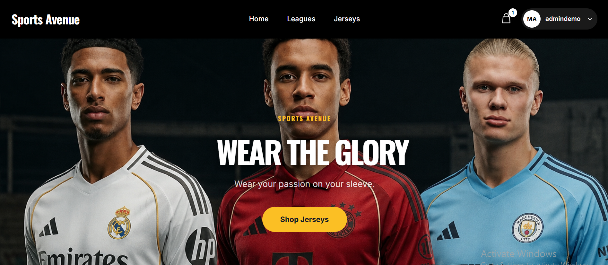
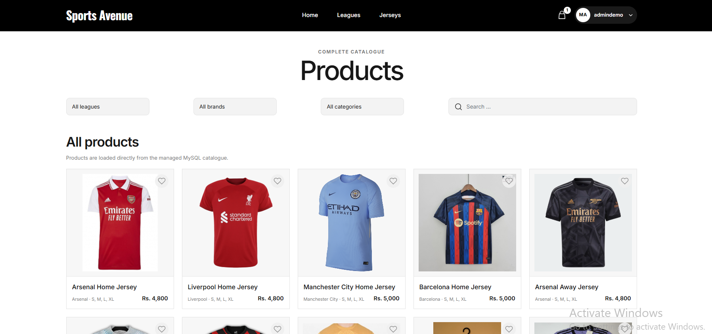
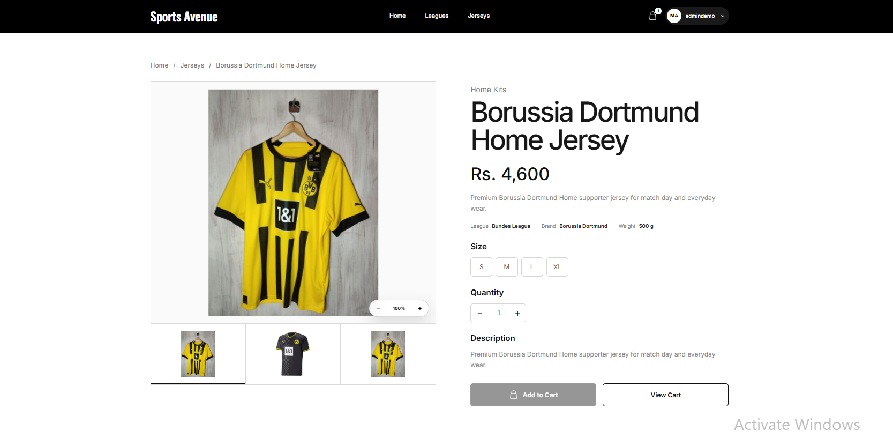
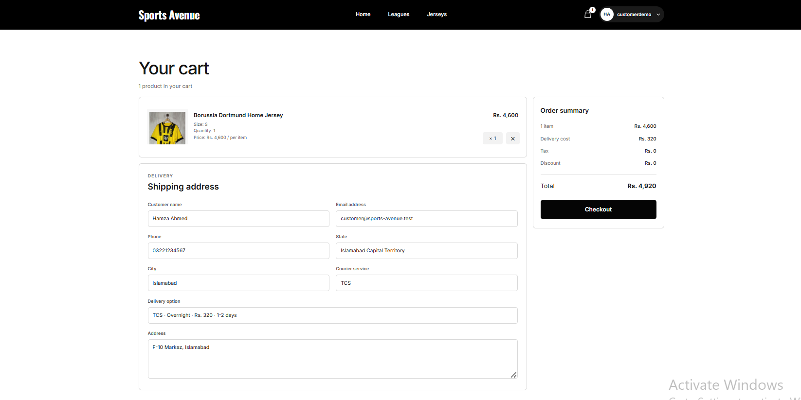
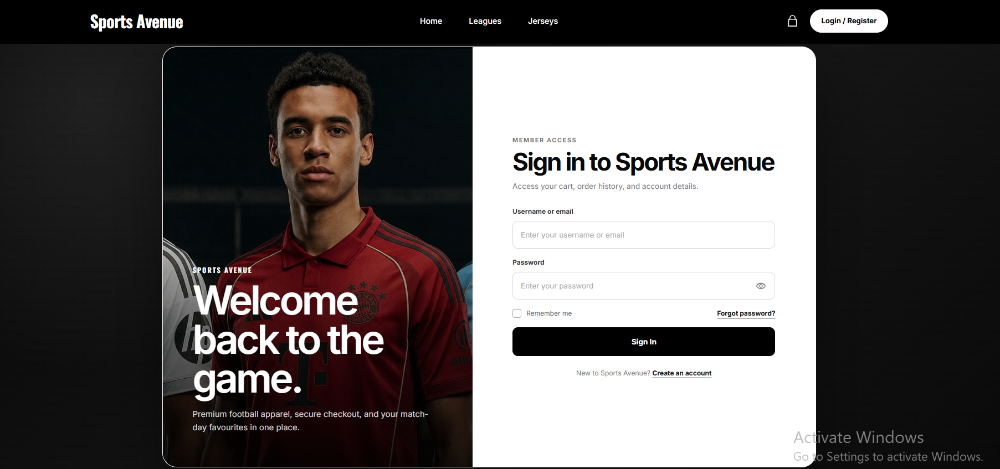
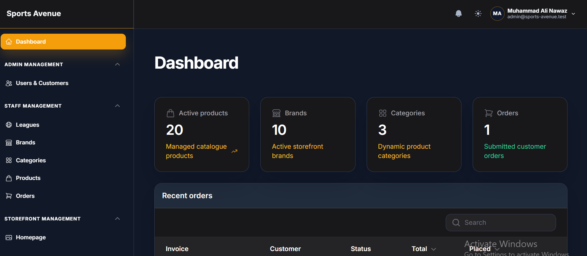

<h1 align="center">🏆 Sports Avenue</h1>

<p align="center">
  <b>A Laravel 12, Livewire 3, Filament 3, and Tailwind CSS ecommerce platform for football jerseys and sports kits with catalogue management, cart, checkout, order history, inventory control, notifications, and role-based administration.</b>
</p>

<p align="center">
  
  
  
  
  
  
  
  
</p>

---

## 📸 Project Screenshots


| Homepage | Products |
|---|---|
|  |  |

| Product Details | Checkout |
|---|---|
|  |  |

| Customer Login | Administration Dashboard |
|---|---|
|  |  |

---

## 🚀 Project Overview

**Sports Avenue** is a complete full-stack Laravel ecommerce web application developed for browsing, managing, and purchasing football jerseys and sports kits.

The customer-facing storefront allows users to explore leagues, brands, categories, and jersey collections; view detailed product information; select sizes and quantities; add products to a cart; calculate Pakistan-based delivery charges; place orders; manage their profile; and review order history.

The application also includes a modern **Filament administration panel** where authorized Admin and Staff users can manage customers, employees, leagues, brands, categories, jerseys, storefront settings, notifications, and customer orders.

---

## 🎯 Project Purpose

A professional ecommerce platform requires more than a simple product listing. It needs catalogue management, inventory control, authentication, authorization, cart logic, checkout validation, shipping calculations, historical order snapshots, account management, administration tools, and reliable automated testing.

**Sports Avenue** combines these requirements into one organized Laravel application designed around a modern customer storefront and a structured administration workflow.

This project was created as a professional portfolio application to demonstrate practical Laravel full-stack development, backend architecture, database design, Livewire components, Filament resources, secure order processing, and maintainable application structure.

---

## 🎯 Key Highlights

- 🏆 Football jersey and sports kit ecommerce platform
- 🛍️ Searchable and filterable jersey catalogue
- 🏟️ League, brand, and category-based product browsing
- 🛒 Authenticated shopping cart workflow
- 📏 Size-specific inventory management
- 🧾 Optional nameset pricing
- 🚚 Pakistan province, city, courier, and shipping-rate workflow
- 💵 Cash on Delivery checkout
- 💳 Midtrans integration foundation for a future online-payment update
- 📦 Order history, order details, and fulfilment tracking
- 👤 Customer profile, avatar, and password management
- 🔐 Registration, login, email verification, and password reset
- 👑 Admin, Staff, and Customer roles
- ⚙️ Filament administration panel
- 🔔 Full-page dashboard notifications
- 🧑‍💼 Customer and employee management
- 🏷️ League, brand, category, and jersey management
- 🖼️ Configurable storefront hero content
- 🔒 Policy-based authorization and account-status enforcement
- 📊 Dashboard statistics and recent orders
- 🧪 Comprehensive automated feature and unit tests
- 🛠️ GitHub Actions and release-verification scripts
- 🌐 Google Socialite structure retained for a future update
- 📡 Pusher and Laravel Echo configuration retained for future realtime features
- 📱 Responsive storefront and administration interface

---

## ✨ Features

### 🛒 Customer Storefront Features

| Feature | Description |
|---|---|
| Home Page | Responsive storefront with configurable hero, leagues, brands, and featured products |
| League Listing | Browse products by football league |
| Brand Browsing | Explore products by managed brands |
| Jersey Catalogue | Search, filter, and paginate available jerseys |
| Jersey Details | View product description, gallery, league, brand, category, sizes, stock, price, and nameset option |
| Shopping Cart | Add products, change quantity, remove items, and review totals |
| Shipping Selection | Select Pakistan province, city, and available courier service |
| Checkout | Complete a validated Cash on Delivery order workflow |
| Order History | Filter and review the authenticated customer's previous orders |
| Order Details | Open a detailed order modal with preserved product snapshots |
| Profile Management | Update profile data, avatar, password, address, and contact details |
| Authentication | Register, login, logout, reset password, and verify email |
| Account Protection | Suspended, blocked, or inactive accounts cannot continue protected workflows |

---

### 🧑‍💼 Admin Panel Features

| Feature | Description |
|---|---|
| Admin Dashboard | View catalogue statistics, order statistics, and recent customer orders |
| Full Notifications Page | Open, read, mark all as read, and remove dashboard notifications in the main content area |
| User Management | Create, view, edit, activate, suspend, block, and delete eligible accounts |
| Employee Management | Admin-only management of Staff and Admin users |
| League Management | Create, view, update, search, and safely delete leagues |
| League Reassignment | Move products to a replacement league before deleting an in-use league |
| Brand Management | Create, view, update, search, and delete brands without deleting associated products |
| Category Management | Create, view, update, search, and delete product categories |
| Jersey Management | Create, view, update, search, filter, paginate, and delete jersey products |
| Storefront Settings | Manage hero content, CTA details, active display settings, and storefront presentation |
| Order Management | View orders, inspect customer and shipping snapshots, and update fulfilment status |
| Profile Management | Update dashboard profile, avatar, and password |
| Theme Controls | Switch between dark and light administration themes |
| Staff Access | Allow Staff operational access while reserving sensitive user management for Admin users |

---

### 🏷️ Product & Catalogue Features

| Feature | Description |
|---|---|
| Jersey Products | Store SKU, slug, name, description, price, nameset price, weight, gallery, and status |
| League Assignment | Associate every product with a managed league |
| Brand Assignment | Optionally associate products with managed brands |
| Category Assignment | Organize products by category |
| Product Images | Support packaged catalogue assets and uploaded public-storage images |
| Stock by Size | Manage stock for sizes such as S, M, L, and XL |
| Sold Quantity | Track sold quantities independently from current stock |
| Featured Products | Control homepage product visibility and display order |
| Active Products | Enable or disable products without removing historical order information |
| Safe Deletion | Preserve historical order snapshots when catalogue records change or are deleted |

---

### 📦 Order, Inventory & Checkout Features

| Feature | Description |
|---|---|
| Cart Items | Preserve selected product, size, quantity, nameset choice, and calculated totals |
| Checkout Validation | Validate customer address, location, courier, stock, and calculated shipping cost |
| Pakistan Shipping | Calculate local shipping from configured city and courier data |
| Cash on Delivery | Create validated COD orders through the active storefront checkout |
| Inventory Transactions | Use database transactions and locking for inventory-sensitive operations |
| Inventory Reservations | Reserve stock safely for payment-related workflows |
| Order Snapshots | Preserve immutable product, customer, and shipping details on completed orders |
| Order Workflow | Enforce allowed fulfilment-status transitions |
| Notifications | Send database notifications after important order updates |
| Payment Webhook Layer | Validate signatures, amounts, transaction identity, terminal states, and duplicate callbacks |
| Future Online Payment | Retain Midtrans services and callback routes for a planned checkout upgrade |

---

## 🧑‍💼 User Roles

| Role | Access Level |
|---|---|
| 👑 Admin | Full administration access, including user management, catalogue management, storefront settings, orders, notifications, and profile tools |
| 🧑‍💼 Staff | Operational administration access for catalogue, orders, notifications, and profile management |
| 👤 Customer | Storefront access, cart, checkout, order history, email verification, and profile management |

---

## 🛠 Tech Stack

| Layer | Technologies |
|---|---|
| Backend | Laravel 12, PHP 8.2+ |
| Database | MySQL / MariaDB |
| Storefront | Blade, Livewire 3, Alpine.js |
| Styling | Tailwind CSS 3, custom responsive CSS |
| Admin Panel | Filament 3 |
| Authentication | Laravel authentication scaffolding and email verification |
| API/Auth Foundation | Laravel Sanctum |
| Social Login Foundation | Laravel Socialite for a future Google authentication update |
| Payment Foundation | Midtrans PHP SDK and secured webhook services |
| Realtime Foundation | Pusher, Laravel Echo, and broadcast configuration |
| Testing | PHPUnit 11, Laravel feature tests, Livewire tests |
| Code Style | Laravel Pint |
| Build Tool | Vite 8 |
| Automation | GitHub Actions, Dependabot, PowerShell and Bash release scripts |
| Package Management | Composer, NPM |

---

## 🏗 Architecture Overview

The project follows Laravel MVC conventions with Livewire components for the customer storefront, Filament resources for administration, policies for authorization, and dedicated services for complex business workflows.

```text
Sports-Avenue/
├── app/
│   ├── Console/
│   ├── Contracts/
│   ├── Data/
│   ├── Filament/
│   │   ├── Pages/
│   │   ├── Resources/
│   │   └── Widgets/
│   ├── Http/
│   │   ├── Controllers/
│   │   ├── Middleware/
│   │   └── Requests/
│   ├── Livewire/
│   ├── Models/
│   ├── Notifications/
│   ├── Observers/
│   ├── Policies/
│   ├── Providers/
│   ├── Services/
│   │   ├── Checkout/
│   │   ├── Inventory/
│   │   ├── Orders/
│   │   ├── Payments/
│   │   └── Users/
│   └── Traits/
├── bootstrap/
├── config/
├── database/
│   ├── factories/
│   ├── migrations/
│   └── seeders/
├── docs/
│   └── screenshots/
├── lang/
├── public/
│   ├── assets/
│   └── images/
├── resources/
│   ├── css/
│   ├── js/
│   └── views/
├── routes/
│   ├── extends/
│   ├── api.php
│   ├── web.php
│   └── webhooks.php
├── scripts/
├── storage/
├── tests/
├── .env.example
├── artisan
├── composer.json
├── package.json
└── README.md
```

---

## 🔄 Application Flow

### Customer Shopping Flow

```text
Visit Storefront
        ↓
Browse Leagues / Brands / Jerseys
        ↓
Search or Filter Catalogue
        ↓
Open Jersey Detail Page
        ↓
Select Size, Quantity, and Nameset Option
        ↓
Add Product to Cart
        ↓
Choose Address, City, and Courier
        ↓
Complete Cash on Delivery Checkout
        ↓
View Order History and Details
```

### Admin Management Flow

```text
Admin / Staff Login
        ↓
Open Filament Dashboard
        ↓
Review Statistics and Notifications
        ↓
Manage Catalogue and Storefront
        ↓
Review Customer Orders
        ↓
Update Fulfilment Workflow
        ↓
Customer Receives Notification
```

### Secure Checkout Flow

```text
Cart Review
        ↓
Authentication and Email Verification
        ↓
Server-Side Stock Validation
        ↓
Shipping Rate Recalculation
        ↓
Database Transaction and Row Lock
        ↓
Order and Snapshot Creation
        ↓
Inventory Update
        ↓
Notification Dispatch
        ↓
Checkout Success Page
```

---

## 🗄 Database Overview

The application uses MySQL or MariaDB with Laravel migrations, factories, and idempotent local seeders.

### Main Data Areas

| Data Area | Purpose |
|---|---|
| Users | Stores Admin, Staff, and Customer accounts, roles, contact data, location, and account status |
| Provinces | Stores Pakistan province data used by customer addresses and shipping |
| Cities | Stores city-level shipping and location data |
| Leagues | Stores managed football league records and display order |
| Brands | Stores managed product brand records |
| Categories | Stores managed product category records |
| Jerseys | Stores product information, pricing, media, status, features, and stock by size |
| Orders | Stores order totals, customer snapshots, shipping snapshots, payment data, and fulfilment state |
| Order Items | Stores immutable product snapshots for every purchased item |
| Order Status Histories | Records fulfilment workflow changes and responsible users |
| Storefront Settings | Stores configurable hero and storefront display content |
| Notifications | Stores dashboard and order-related database notifications |
| Jobs / Failed Jobs | Supports Laravel queue infrastructure |
| Password Reset Tokens | Supports secure password-reset workflows |
| Personal Access Tokens | Supports future Sanctum-based API authentication |

---

## 🔐 Security Implementations

| Security Area | Implementation |
|---|---|
| Authentication | Registration, login, logout, password reset, and email verification |
| Password Security | Laravel hashing and validated password rules |
| Login Protection | Rate limiting and session regeneration |
| Account Status | Active, inactive, suspended, and blocked account enforcement |
| Role Access | Separate Admin, Staff, and Customer permissions |
| Authorization | Laravel policies for users, catalogue resources, storefront settings, and orders |
| Protected Routes | Cart, checkout, order history, profile, and dashboard routes use authentication middleware |
| Admin Panel Protection | Filament access is limited to eligible Admin and Staff accounts |
| CSRF Protection | Laravel CSRF middleware protects state-changing browser requests |
| Security Headers | Content Security Policy and modern response headers |
| Trusted Hosts | Host validation middleware protects generated application URLs |
| Inventory Safety | Transactions and row locks protect stock-sensitive operations |
| Historical Data | Immutable order-item snapshots protect completed order history |
| Webhook Verification | Signature, amount, transaction, state, idempotency, and replay checks |
| Demo Seeder Guard | Demonstration seeding is blocked in production by default |
| Administrator Protection | The final Admin account cannot be deleted |

---

## ⚡ Performance & Code Quality

- Uses Laravel MVC conventions and strict PHP declarations in core application files
- Uses service classes for checkout, payment, inventory, order, shipping, and account workflows
- Uses Livewire components for reactive storefront functionality
- Uses Filament resources, pages, tables, forms, and widgets for administration
- Uses policies to centralize authorization decisions
- Uses Eloquent relationships and eager loading for related catalogue and order data
- Uses pagination for storefront and administration lists
- Uses database indexes, foreign keys, and transactions
- Uses immutable order snapshots to avoid expensive historical joins and data corruption
- Uses Vite for optimized production asset compilation
- Uses Laravel Pint for consistent PHP formatting
- Uses Composer and NPM lockfiles for reproducible dependency installation
- Uses GitHub Actions and Dependabot for continuous verification and dependency monitoring
- Includes PowerShell and Bash release-verification scripts
- Includes comprehensive automated unit, feature, authorization, Livewire, checkout, payment, and security tests

---

## 📡 Routes / System Areas

| Area | Purpose |
|---|---|
| `/` | Storefront homepage |
| `/leagues` | League listing |
| `/jerseys` | Searchable and filterable jersey catalogue |
| `/jersey/{jersey}` | Jersey detail page |
| `/cart` | Authenticated and verified customer cart and checkout |
| `/order-history` | Authenticated customer order history |
| `/profile` | Customer profile management |
| `/login` | User login |
| `/register` | User registration |
| `/verify-email` | Email-verification workflow |
| `/forgot-password` | Password-reset request |
| `/checkout/success/{order}` | Authorized checkout success page |
| `/payment/finish` | Payment gateway return foundation |
| `/payment/unfinish` | Pending payment return foundation |
| `/payment/error` | Failed payment return foundation |
| `/payment/webhook` | Secured payment callback endpoint |
| `/admin` | Filament administration panel |
| `/admin/notifications` | Full-page Admin and Staff notification centre |
| `/api/user` | Sanctum-authenticated API user foundation |

> Google login routes are intentionally reserved for a future update and are not active in the current release.

---

## ⚙️ Installation Guide

### Requirements

- PHP 8.2 or higher
- Composer 2.8 or higher
- Node.js 20.19+ or 22.12+
- NPM
- MySQL or MariaDB
- XAMPP, WAMP, Laragon, or a comparable local PHP environment
- Git
- Required PHP extensions: Ctype, cURL, DOM, Fileinfo, GD, Intl, Mbstring, OpenSSL, PDO MySQL, Tokenizer, XML, and Zip

---

### 1️⃣ Clone the Repository

```bash
git clone https://github.com/CodeByMan/Sports-Avenue.git
cd Sports-Avenue
```

---

### 2️⃣ Install PHP Dependencies

```bash
composer install
```

---

### 3️⃣ Install Frontend Dependencies

```bash
npm ci
```

Use `npm install` only when intentionally updating the lockfile.

---

### 4️⃣ Create Environment File

For Windows PowerShell:

```powershell
Copy-Item .env.example .env
```

For macOS or Linux:

```bash
cp .env.example .env
```

---

### 5️⃣ Generate Application Key

```bash
php artisan key:generate
```

---

### 6️⃣ Configure Database

Create a MySQL database:

```sql
CREATE DATABASE sports_avenue
    CHARACTER SET utf8mb4
    COLLATE utf8mb4_unicode_ci;
```

Update `.env`:

```env
APP_NAME="Sports Avenue"
APP_ENV=local
APP_DEBUG=true
APP_URL=http://127.0.0.1:8000
APP_TIMEZONE=Asia/Karachi

DB_CONNECTION=mysql
DB_HOST=127.0.0.1
DB_PORT=3306
DB_DATABASE=sports_avenue
DB_USERNAME=root
DB_PASSWORD=
```

Update the username and password according to your local database configuration.

---

### 7️⃣ Configure Local Application Services

Recommended local configuration:

```env
BROADCAST_CONNECTION=log
CACHE_STORE=file
FILESYSTEM_DISK=public
QUEUE_CONNECTION=sync
SESSION_DRIVER=file
SESSION_SECURE_COOKIE=false

MAIL_MAILER=log
MAIL_FROM_ADDRESS="hello@sports-avenue.test"
MAIL_FROM_NAME="${APP_NAME}"

ALLOW_DEMO_SEEDING=false
DEMO_USER_PASSWORD=LocalDemoOnly!2026
SHIPPING_ORIGIN_PROVIDER_ID=101
```

Optional future integrations can remain empty during normal local development:

```env
MIDTRANS_SERVER_KEY=
MIDTRANS_CLIENT_KEY=
MIDTRANS_PRODUCTION=false
MIDTRANS_SANITIZED=true
MIDTRANS_3DS=true
MIDTRANS_ENABLED_PAYMENTS=credit_card

PUSHER_APP_ID=
PUSHER_APP_KEY=
PUSHER_APP_SECRET=
PUSHER_APP_CLUSTER=mt1

GOOGLE_CLIENT_ID=
GOOGLE_CLIENT_SECRET=
GOOGLE_CLIENT_REDIRECT=
```

The current storefront checkout uses Cash on Delivery. Midtrans, Pusher, and Google authentication support are retained for planned future releases.

---

### 8️⃣ Run Migrations and Seeders

```bash
php artisan migrate --seed
```

The local seeders create Pakistan region data, demonstration users, catalogue records, storefront settings, and a sample order.

---

### 9️⃣ Link Storage and Refresh Filament Assets

```bash
php artisan storage:link
php artisan filament:upgrade
```

---

### 🔟 Build Frontend Assets

For local development:

```bash
npm run dev
```

For a production-style build:

```bash
npm run build
```

---

### 1️⃣1️⃣ Start Laravel Server

```bash
php artisan optimize:clear
php artisan serve --host=127.0.0.1 --port=8000
```

Open the storefront:

```text
http://127.0.0.1:8000
```

Open the administration panel:

```text
http://127.0.0.1:8000/admin
```

---

## 🏗 Build for Production

Compile production frontend assets:

```bash
npm ci
npm run build
```

Recommended production environment values:

```env
APP_ENV=production
APP_DEBUG=false
SESSION_SECURE_COOKIE=true
ALLOW_DEMO_SEEDING=false
```

Optimize Laravel during deployment:

```bash
php artisan optimize
php artisan filament:upgrade
```

Use HTTPS, production database credentials, a real mail provider, a queue worker when required, and environment-specific payment credentials.

---

## 🔑 Demo Login Credentials

After running the database seeders, use the following local demonstration accounts.

> Default local password: the value configured in `DEMO_USER_PASSWORD`.

| Role | Name | Username | Email | Default Local Password | Access |
|---|---|---|---|---|---|
| 👑 Admin | Muhammad Ali Nawaz | `admindemo` | `admin@sports-avenue.test` | `LocalDemoOnly!2026` | Full `/admin` access |
| 🧑‍💼 Staff | Ayesha Khan | `staffdemo` | `staff@sports-avenue.test` | `LocalDemoOnly!2026` | Operational `/admin` access |
| 👤 Customer | Hamza Ahmed | `customerdemo` | `customer@sports-avenue.test` | `LocalDemoOnly!2026` | Storefront, cart, checkout, order history, and profile |

> These are demonstration credentials only. Never use them for a real production deployment.

Useful query to verify seeded users:

```sql
SELECT id, name, username, email, role, status
FROM users
ORDER BY id;
```

---

## 📁 Important Folder Structure

```text
app/Filament/
├── Pages/
│   ├── Dashboard.php
│   └── Notifications.php
├── Resources/
│   ├── BrandResource.php
│   ├── CategoryResource.php
│   ├── JerseyResource.php
│   ├── LeagueResource.php
│   ├── OrderResource.php
│   ├── ProfileResource.php
│   ├── StorefrontSettingResource.php
│   └── UserResource.php
└── Widgets/
    ├── CatalogStatsOverview.php
    ├── OrderStatsOverview.php
    └── RecentOrders.php

app/Livewire/
├── Cart.php
├── Home.php
├── Jersey.php
├── JerseyDetail.php
├── League.php
├── NavbarAuth.php
├── OrderHistory.php
└── Profile.php

app/Services/
├── Checkout/
├── Inventory/
├── Orders/
├── Payments/
└── Users/

app/Models/
├── Brand.php
├── Category.php
├── City.php
├── Jersey.php
├── League.php
├── Order.php
├── OrderItem.php
├── OrderStatusHistory.php
├── Province.php
├── StorefrontSetting.php
└── User.php

docs/screenshots/
├── homepage.png
├── jerseys.png
├── jersey_details.png
├── checkout.png
├── login.png
└── dashboard.png
```

---

## 🧪 Testing & Verification Checklist

- [x] Composer dependencies install successfully
- [x] NPM dependencies install successfully
- [x] Laravel application key generates successfully
- [x] MySQL database connection works
- [x] Migrations run successfully
- [x] Seeders run successfully
- [x] Storage link works
- [x] Frontend production build succeeds
- [x] Storefront homepage renders
- [x] League and jersey catalogue pages render
- [x] Jersey detail page works
- [x] Cart and checkout workflow works
- [x] Customer order history works
- [x] Customer profile works
- [x] Admin and Staff dashboard access works
- [x] Full-page notifications work
- [x] Brand deletion preserves associated products
- [x] League deletion supports product reassignment
- [x] Role-restricted Dashboard link works
- [x] Authentication and account-status tests pass
- [x] Payment-webhook security tests pass
- [x] Complete automated test suite passes

Run the complete test suite:

```bash
php artisan optimize:clear
php artisan test
```

Run formatting verification:

```bash
composer lint
```

Run the complete release verification on Windows:

```powershell
.\scripts\verify-release.ps1
```

Run the complete release verification on Linux or macOS:

```bash
bash scripts/verify-release.sh
```

---

## 👨‍💻 Author

**Muhammad Ali Nawaz**  
PHP / Laravel Developer

---

## 📄 License

This project is open-sourced software licensed under the [MIT License](LICENSE).

---

<p align="center">
  <b>⭐ If you like this project, consider starring the repository!</b>
</p>
